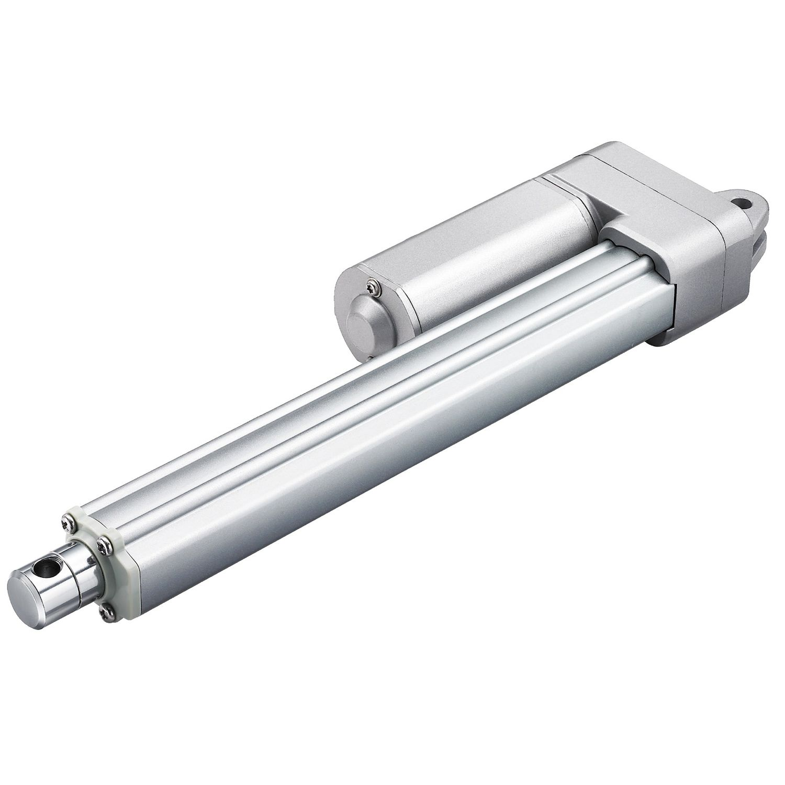
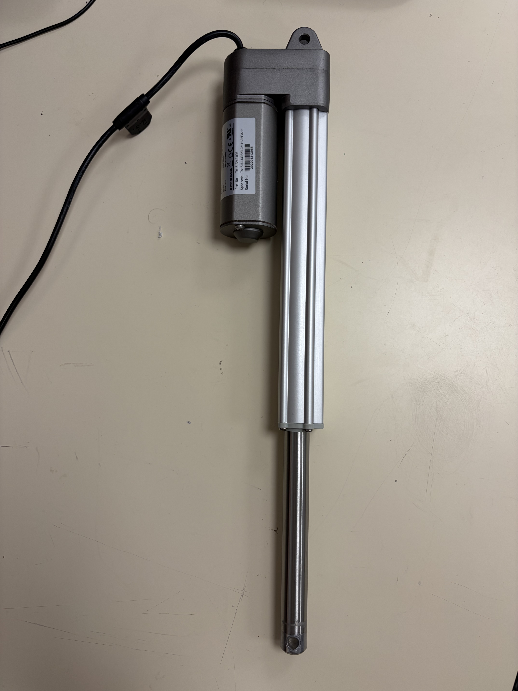

# Vérin électrique TiMOTION TA16-5J-1 (documentation réalisée par essais, répertoriés dans Rapport_de_tests.md)

## 1. Présentation générale

Le **TiMOTION TA16-5J-1** est un actionneur linéaire électrique permettant de convertir l'énergie électrique en un mouvement mécanique de translation. Il est utilisé pour réaliser des mouvements de poussée et de traction afin de déplacer, lever ou positionner un élément mécanique.

*Figure 1 — Vue générale du vérin électrique TiMOTION TA16-5J-1.*
 

 
Cet actionneur peut être intégré dans différents systèmes automatisés nécessitant un déplacement linéaire motorisé. Son intégration dépend notamment des contraintes mécaniques, électriques et environnementales de l'application.

## 2. Principe de fonctionnement

Le vérin fonctionne grâce à un moteur électrique qui entraîne un mécanisme de transmission interne. Ce mécanisme transforme la rotation du moteur en un déplacement linéaire de la tige.

Selon le sens de commande du moteur, la tige sort ou rentre, permettant ainsi de modifier la position de l'élément mécanique auquel elle est reliée.

Le pilotage du vérin nécessite une alimentation électrique et un système de commande adaptés à ses caractéristiques nominales.

## 3. Caractéristiques techniques

Les caractéristiques relevées sur l'actionneur TiMOTION TA16-5J-1 sont les suivantes :

| Paramètre | Valeur |
|---|---|
| Fabricant | TiMOTION |
| Référence | TA16-5J-1 |
| Tension d'alimentation | 24 V DC |
| Facteur de marche (*Duty cycle*) | 10 % |
| Durée maximale de fonctionnement continu | 2 minutes |
| Temps de repos indiqué | 18 minutes |
| Charge indiquée (*Load*) | 2 000 N |
| Courant maximal (*Current*) | 4,25 A |
| Sortie minimale de la tige, vérin replié | 24 mm |
| Sortie maximale de la tige | 164 mm |
| Course utile de la tige | 140 mm |

### 3.1. Tension d'alimentation

Le vérin fonctionne sous une tension d'alimentation de **24 V en courant continu (DC)**. L'alimentation et le système de commande doivent être compatibles avec cette tension.

### 3.2. Course de la tige

La tige présente une sortie minimale de **24 mm** lorsque le vérin est en position repliée, et une sortie maximale de **164 mm** lorsqu'elle est complètement déployée.

La course utile correspond à la différence entre ces deux positions :

\[
\text{Course utile} = 164 - 24 = 140\ \text{mm}
\]

Le déplacement linéaire exploitable de la tige est donc de **140 mm**.

*Figure 2 — Vérin rétracté au maximum.*
 

 

*Figure 3 — Vérin déplié au maximum.*
 

 

### 3.3. Facteur de marche

Le facteur de marche est de **10 %**, avec un cycle de fonctionnement indiqué de 2 minutes en marche et 18 minutes à l'arrêt. Cette limitation doit être respectée afin de prévenir une surchauffe et une usure prématurée de l'actionneur.

### 3.4. Charge

La charge indiquée est de **2 000 N**. Cette valeur correspond à un effort équivalent au poids d'une masse d'environ 204 kg dans les conditions de la gravité terrestre. Cette équivalence ne constitue pas une garantie de capacité de levage : l'effort admissible dépend des conditions de montage et d'utilisation.

### 3.5. Courant électrique

Le courant maximal indiqué est de **4,25 A**. L'alimentation électrique et le dispositif de commande doivent être dimensionnés en tenant compte de cette valeur et des éventuels appels de courant au démarrage (la documentation officielle prévoit jusqu'au double de la valeur initiale lors du démarrage du moteur).

## 4. Intégration dans un système automatisé

L'intégration du vérin TiMOTION TA16-5J-1 nécessite de prendre en compte les efforts appliqués, la course utile, la vitesse souhaitée et les conditions de fonctionnement.

Le système de commande doit être compatible avec l'alimentation en 24 V DC et capable de gérer le courant nécessaire au fonctionnement de l'actionneur. Il convient également de prévoir une protection électrique adaptée et de respecter le facteur de marche spécifié.

Une attention particulière doit être portée à la fixation mécanique, à la prévention des surcharges et à la limitation des risques de coincement lors des déplacements.

## 5. Connexions électriques et brochage

Cette section décrit les connexions électriques du vérin TiMOTION TA16-5J-1 afin de faciliter son raccordement à un système de commande.

### 5.1. Connecteur

Le vérin est équipé d'un connecteur électrique permettant de relier l'actionneur à son alimentation et à son système de commande.

Les informations suivantes doivent être relevées afin d'identifier précisément le connecteur :

- Type et référence du connecteur ;
- Nombre de broches ;
- Disposition des broches ;
- Correspondance entre les broches et les conducteurs électriques.

### 5.2. Identification des fils

Les conducteurs électriques doivent être identifiés avant le raccordement. Pour chaque fil, il convient de préciser sa couleur, sa fonction et sa connexion au système de commande.

| Couleur du fil | Fonction électrique |
|---|---|
| JAUNE | VDC +24 V (extension) |
| VERT | VDC +24 V (rétractation) |
| ROUGE | VCC +5 V |
| NOIR | GND |
| BLANC | Signal hall 1 |
| BLEU | Signal hall 2 |

*Remarque : le brochage et la fonction des fils doivent être confirmés à partir de la documentation constructeur ou par des vérifications électriques adaptées avant toute mise sous tension.*

## 6. Objectif de cette documentation

Cette documentation technique a été réalisée afin de centraliser les informations relatives au vérin électrique TiMOTION TA16-5J-1 et de faciliter son utilisation dans le cadre du projet.

Auparavant, cet actionneur n'avait pas encore été utilisé dans le cadre du projet. Les informations concernant ses caractéristiques techniques, son fonctionnement et ses connexions électriques n'étaient donc pas toutes connues ou documentées.

L'objectif de ce travail est ainsi d'identifier les caractéristiques du vérin, de clarifier son principe de fonctionnement et de déterminer les modalités de raccordement nécessaires à son intégration dans le système.

Cette documentation constitue une base de référence pour les futures utilisations du vérin. Elle permet de conserver les informations collectées et de faciliter les opérations de montage, de raccordement, de mise en service et de maintenance.

## 7. Documentation constructeur

Pour obtenir des informations complémentaires sur les dimensions, la course, la vitesse de déplacement et les possibilités de retour de position, il convient de consulter la documentation technique correspondant à la référence exacte du vérin.

[Consulter le documentation officielle de TiMOTION]((https://www.timotion.com/_upload/files/DataSheet_TA16-V_EN.pdf))

*Remarque : les caractéristiques présentées ci-dessus reprennent les indications relevées sur l'actionneur. Les paramètres non indiqués, notamment la course, la vitesse et le type de retour de position, restent à confirmer à partir de la documentation constructeur.*
